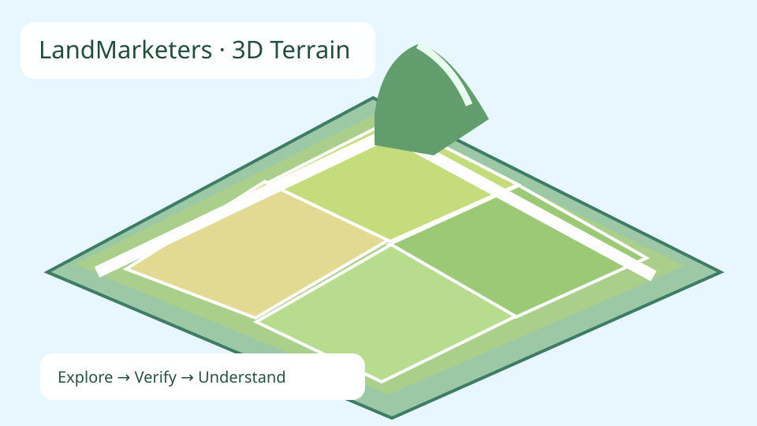

# LandMarketers

한국의 농지·토지 **실거래 및 규제 정보 탐색**과 활용 가능성 검토를 돕는 지도 서비스. Three.js 3D 지형/필지 탐색을 사용하되 **공식 정보와 시각화 추정치 구분**을 최우선으로 한다.

## 문서
- [제품 요구사항](docs/PRODUCT_REQUIREMENTS.md)
- [토지 데이터 및 법규 로직](docs/DATA_AND_BUSINESS_LOGIC.md)
- [Three.js 지형 UX](docs/THREEJS_UX.md)
- [아키텍처](docs/ARCHITECTURE.md)
- [테스트 및 로드맵](docs/TEST_AND_ROADMAP.md)

## 범위 경계
첫 출시: 거래 내역/용도지역/규제정보/공식 원본 연결, '활용 검토 체크리스트'. 거래 당사자 연결, 중개 수수료, 유휴토지 확정 판정, 투자 수익 보장은 하지 않는다.

## 기술
Next.js + TypeScript + Three.js/R3F + MapLibre + Python ETL + PostGIS. Vercel 테스트와 Ubuntu 데이터 작업 분리.

문서와 가설만 존재하며 현재 제품/법적 적합성 인증을 의미하지 않는다.

## Agent-driven TDD & 학습 문서 (2026-11-22 추가)
- [엔지니어링 원칙: 선언적 코드·가독성·예측 가능성·응집도·결합도](docs/19_ENGINEERING_PRINCIPLES.md)
- [코드 읽기와 실습 순서](docs/20_LEARNING_PATH.md)
- [테스트 증거 기반 품질 게이트](docs/21_QUALITY_GATES.md)
- [PR 단위 구현 백로그](docs/22_IMPLEMENTATION_SPRINTS.md)
- [홈서버 / Vercel / 도메인 운영](docs/23_OPERATIONS_AND_COST.md)
- [Agent 개발 규약](agent/AGENT_RULES.md)
- [작업 템플릿](agent/TASK_TEMPLATE.md)

## 디자인 콘셉트 (오리지널 SVG)

예전 채팅에 표시된 외부 사진과 동일한 이미지가 아닌 **이 저장소를 위해 새로 작성한 콘셉트 SVG**이다. 실제 DB나 작동하는 화면의 스크린샷이 아니다.

## 개발 진행 상태
- 완료: 요구사항/기술 규약/학습 계획 문서 및 오리지널 SVG
- 미완료: 앱 코드, 실제 데이터 계약 검증, TDD 실행 로그, Three.js 실제 렌더러, 자동화 CI, Vercel 배포
- 개발 프로세스: Agent가 테스트 작성→실패 로그→구현→테스트 통과 증명→코드 읽기 문서 제공. 창업자는 기술 승인 부담 없이 학습 및 제품 의견 제공.

## Mobile-first · 독립 앱 구조 (2026-11-22)
**이 저장소는 나머지 두 프로젝트와 별도 앱이다.** 데스크톱에 맞춘 기존 시각 레퍼런스는 디자인 무드 참고용이며 모바일 단일 화면에 모든 통계·지도·필터를 넣지 않는다.

- [모바일 우선 페이지 흐름 · 라우팅 · 태블릿/PC 배치 · TDD 검증](docs/25_MOBILE_FIRST_INFORMATION_ARCHITECTURE.md)
